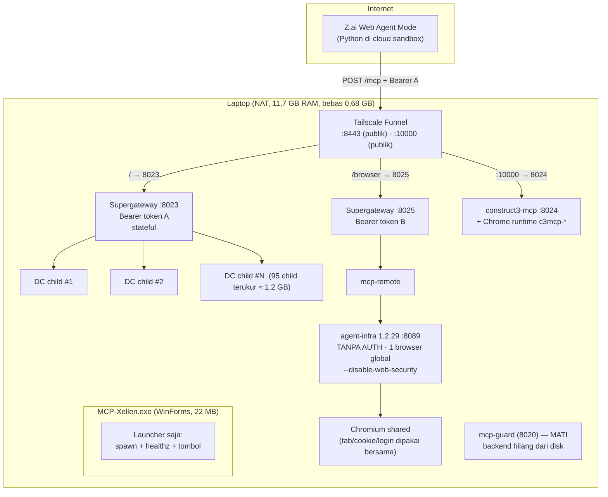
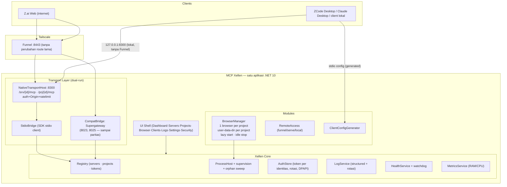

# MCP XELLEN — FULL ARCHITECTURE AUDIT & PRODUCTION READINESS

| | |
|---|---|
| **Tanggal audit** | 11 November 2026 |
| **Scope** | Seluruh sistem MCP Xellen di `D:\MCP-Bridge` + lingkungan runtime Windows |
| **Metode** | (1) Audit statis source code & konfigurasi (read-only, dengan referensi file:line); (2) Pengukuran runtime live (proses, port, RAM, Funnel) pada saat audit; (3) Verifikasi terhadap dokumentasi resmi (MCP Specification 2025-06-18, SDK C# resmi MCP, Tailscale KB) |
| **Batasan** | AUDIT & PERENCANAAN SAJA. Tidak ada file, proses, port, Funnel, token, atau konfigurasi yang diubah/dihapus/dimatikan selama audit. |
| **Status** | Menunggu persetujuan pemilik sebelum implementasi apa pun |

**Legenda yang dipakai di seluruh dokumen:**
- **[FAKTA]** — terverifikasi dari kode, pengukuran live, atau dokumentasi resmi (dengan sumber).
- **[ASUMSI]** — dugaan yang masuk akal tetapi belum diverifikasi; wajib diverifikasi sebelum dijadikan dasar keputusan.
- **[REKOMENDASI]** — saran arsitektural dari auditor; keputusan tetap di tangan pemilik.

---

## 1. EXECUTIVE SUMMARY

MCP Xellen saat ini **bukan** aplikasi manajemen MCP, melainkan **satu launcher WinForms untuk satu gateway**: ia men-spawn Supergateway yang membungkus Desktop Commander (stdio) menjadi endpoint Streamable HTTP di `127.0.0.1:8023` dengan Bearer token, dan dipublikasikan ke internet via Tailscale Funnel `:8443`. Pola ini **terbukti bekerja** untuk use case Z.ai Web Agent (terverifikasi live saat audit), tetapi memiliki enam masalah struktural yang menghalangi status production-ready:

1. **Kebocoran proses terukur (kritis, live).** Model *child-per-session* Supergateway meninggalkan puluhan proses child Desktop Commander yang masih hidup: **95 child DC (≈1.228 MB RAM) pada pengukuran pertama, 67 proses node pada pengukuran kedua beberapa detik kemudian** — akumulasi lintas waktu (proses tertua masih hidup sejak 10 Nov 2026 20:43). RAM bebas laptop hanya **0,68 GB dari 11,71 GB** pada saat audit.
2. **Browser MCP yang ada tidak terisolasi dan tanpa auth di lapisan browser.** `@agent-infra/mcp-server-browser` 1.2.29 memakai **satu global browser per proses server** dan **menerima `initialize` tanpa token** (dibuktikan live: HTTP 200, `serverInfo: "Web Browser" 1.2.29`). Semua client yang mencapainya berbagi tab, cookie, dan login yang sama.
3. **Production 8020 mati dan dokumentasi tidak akurat.** Tidak ada listener di 8020, dan Funnel 443 tidak terdaftar (hanya 8443 & 10000 yang aktif). Wiring production (`aceh-camera-readonly`) bahkan tidak ada di disk.
4. **Tidak ada konsep project/identitas.** Satu token dipakai untuk seluruh Desktop Commander — yang secara desain bisa mengeksekusi perintah arbitrer (permukaan RCE publik di balik satu bearer token).
5. **Tidak ada supervision/ops.** Tanpa watchdog, tanpa log rotation (log app 65 MB), tanpa autostart/recovery, tanpa installer/uninstaller.
6. **Fungsi inti bergantung pada "lem" eksternal** (Supergateway, mcp-remote, Funnel CLI manual) tanpa lapisan abstraksi milik aplikasi — membuatnya sulit dikembangkan menjadi produk universal.

**Kesimpulan arsitektural utama** [REKOMENDASI]: Funnel **tetap diperlukan** hanya untuk client berbasis internet (Z.ai Web) dan tidak dapat digantikan selain oleh tunnel setara; Supergateway **dapat dan sebaiknya digantikan secara bertahap** oleh transport Streamable HTTP native di dalam Xellen (feasible — SDK C# resmi mendukungnya) dengan strategi *dual-run* tanpa menghentikan endpoint yang hidup. Roadmap 6 fase (P0–P5) disajikan di Bagian 17, dengan fix kebocoran proses sebagai prioritas tertinggi karena berdampak langsung ke RAM laptop.

---

## 2. KONDISI SISTEM SAAT INI (SNAPSHOT LIVE 11 NOV 2026)

### 2.1 Sumber daya mesin [FAKTA — diukur live]

| Metrik | Nilai saat audit |
|---|---|
| RAM total | 11,71 GB |
| RAM bebas | **0,68 GB** (≈5,8%) |
| `chrome.exe` | 71 proses — **3.582 MB** (campuran: Chrome pribadi user, browser construct3 `c3mcp-chrome-*` dengan `--remote-debugging-port`, browser shared agent-infra) |
| `node.exe` | 67 proses — **1.151 MB** |
| Child Desktop Commander (`...\desktop-commander-local\package\dist\index.js --no-onboarding`) | **95 proses — 1.228 MB** (pengukuran ke-1); pengukuran ke-2 beberapa detik berikutnya total node turun ke 67 → **churn/akumulasi tinggi** |
| `MCP-Xellen.exe` | 1 proses, 22 MB (`publish-direct\MCP-Xellen.exe`) |
| `tailscaled.exe` | 2 proses, ±46 MB |
| Daemon `@browsermcp/mcp` (`C:\laragon\www\_bmcp`) | 1 proses, 20 MB |

> Catatan kejujuran: selisih 95 → 67 dalam beberapa detik menunjukkan child DC lahir/mati cepat (sesi Z.ai aktif saat audit). Yang jelas: **puluhan** child DC hidup bersamaan dan yang tertua berumur >14 jam — ini bukan perilaku "satu sesi satu child lalu dibersihkan". Akar penyebab pasti (timeout tidak terpicu vs orphan dari gateway yang pernah mati) perlu dikonfirmasi saat implementasi P1; yang terukur adalah dampaknya: >1 GB RAM.

### 2.2 Port & endpoint [FAKTA — diukur live]

| Port | Status live | Bukti | Peran menurut file |
|---|---|---|---|
| 8023 (Xellen staging DC) | **HIDUP** — `/healthz` 200; initialize tanpa token → **401** (auth bekerja) | curl live | Gateway utama, Bearer `mcp-xellen-staging-token.txt` |
| 8025 (browser gateway) | **HIDUP** — `/healthz` 200; tanpa token → **401** | curl live | Supergateway+mcp-remote di depan agent-infra |
| 8089 (agent-infra browser) | **HIDUP — TANPA AUTH**: initialize tanpa token → **200**, `serverInfo:"Web Browser" 1.2.29` | curl live | Browser MCP shared, loopback |
| 8024 (construct3) | HIDUP — listening (PID 21624) | netstat | MCP Construct 3 / ShortShift |
| **8020 (production)** | **MATI** — tidak ada listener, `/healthz` gagal | netstat+curl | Production guard bridge; backend `aceh-camera-readonly\server.mjs` **tidak ada di disk** |
| 8801, 8802 | **MATI** | curl | Target route Funnel `/oc`, `/wcu` → **route basi** |

### 2.3 Tailscale Funnel [FAKTA — `tailscale funnel status` live]

```
https://laptop-see8pp9p.tail943ca4.ts.net:8443 (Funnel on)   ← PUBLIK ke internet
|-- /        proxy http://127.0.0.1:8023     (MCP Xellen / Desktop Commander)
|-- /oc      proxy http://127.0.0.1:8801     (layanan MATI — route basi)
|-- /wcu     proxy http://127.0.0.1:8802     (layanan MATI — route basi)
|-- /browser proxy http://127.0.0.1:8025     (browser MCP gateway)
https://laptop-see8pp9p.tail943ca4.ts.net:10000 (Funnel on)  ← PUBLIK ke internet
|-- /        proxy http://127.0.0.1:8024     (Construct 3 MCP)
+ dua listener tailnet-only di :8801 dan :8802 (bukan Funnel)
```

**Penting:** Port **443 tidak terdaftar** sebagai Funnel. Klaim dokumentasi ("Production :443 → 8020", `README-MCP-XELLEN.md`, Program.cs:58) **tidak sesuai realitas saat ini** [FAKTA].

### 2.4 Inventaris komponen [FAKTA — audit statis]

| Komponen | Lokasi | Teknologi/versi | Status |
|---|---|---|---|
| Launcher WinForms | `desktop-commander-local\app\` (csproj net10.0-windows, `Program.cs` 219 baris) | .NET 10 WinForms | Aktif (shortcut desktop → `publish-direct\MCP-Xellen.exe`) |
| Supergateway | `mcp-guard-stack\node_modules\supergateway` | 4.2.1 (Node) | Aktif (8023, 8025) |
| Desktop Commander (vendored) | `desktop-commander-local\package\` | 0.3.1 (stdio MCP) | Aktif sebagai backend 8023 |
| Browser MCP (agent-infra) | npx cache `D:\DevCache\npm-cache\_npx\c771b78cb280930b\...` | 1.2.29 | Aktif (8089→8025), **shared, tanpa auth, tanpa user-data-dir** |
| Browser MCP (ekstensi Chrome) | `C:\laragon\www\_bmcp` + daemon `~\.browsermcp` | @browsermcp/mcp (daemon :9010) | Terpisah; produk berbeda; dipakai Z.ai via Xellen |
| Guard stack | `mcp-guard-stack\` (mcp-guard 0.3.1, pp.config.yaml enforce) | Node | Terpasang; **production 8020 mati** karena backend hilang |
| Construct 3 MCP | `construct3-mcp\` | 1.10.0 (TS, 70+ test) | Aktif (8024, Funnel :10000) |
| Token | `D:\MCP-Bridge\secrets\` — 6 file plaintext (24–64 B) | — | Dipakai supergateway `--apiKeyFile` |
| Log | `mcp-xellen-app.log` **65,9 MB**; `browser-mcp.log`; `pp-receipts.jsonl` 1,8 MB | — | Tanpa rotasi |
| Autostart | **Tidak ada** (tanpa Task Scheduler/registry/service) | — | Start manual |
| Repo publikasi | `MCP-Xellen-publication\` (git, CI GitHub Actions, install.ps1) | — | Mirror siap-GitHub, tidak aktif |
| Prototipe OAuth | `app\xellen-oauth-proxy.mjs` (8021/8022, PKCE, pairing 6 digit) | Node | **Aset tidur** — belum terpakai |

### 2.5 Cara kerja aplikasi saat ini [FAKTA — `Program.cs`]

`MainForm.Shown` → `StartServer()` (Program.cs:67,70): spawn `node supergateway --stdio "node DC\dist\index.js --no-onboarding" --outputTransport streamableHttp --port 8023 --host 127.0.0.1 --apiKeyFile <token> --stateful --sessionTimeout 1800000 --healthEndpoint /healthz` → poll `/healthz` tiap 1,5 dtk → tombol: Copy Z.ai Magic Prompt (prompt Python+Bearer tersimpan di kode, Program.cs:158–176), Locate Token File, Verify Gateway, Stop (`Kill(entireProcessTree:true)`, Program.cs:206). Log stdout/stderr → `File.AppendAllText` tanpa rotasi (Program.cs:214–218). Form tunggal 570×365, semua konstanta hard-coded (Program.cs:20–27).

---

## 3. ARSITEKTUR EXISTING

### 3.1 Narasi

```
Z.ai Web Agent (cloud sandbox)
   │  Python requests, Bearer <token dari file upload>
   ▼
Tailscale Funnel :8443 (TLS otomatis, relay Tailscale, IP laptop tersembunyi)
   │  /mcp        → 127.0.0.1:8023
   │  /browser    → 127.0.0.1:8025
   ▼
Supergateway 4.2.1 (Node, per endpoint)
   │  auth Bearer (--apiKeyFile, SHA-256 constant-time, 401 jika absen)
   │  --stateful: SATU child stdio PER SESI HTTP (Mcp-Session-Id per sesi)
   ▼
Desktop Commander 0.3.1 (stdio)  ← dieksekusi perintah, file ops, dll.
```

Untuk browser: rantai kedua `Supergateway(8025) → mcp-remote → agent-infra(8089, HTTP) → Chromium shared` — lapisan browser **tanpa auth dan satu browser global**.

Untuk client lokal (ZCode Desktop dll.): client mem-spawn server MCP stdio sendiri sesuai konfigurasinya (contoh nyata di mesin ini: server MCP shadcn, ant-design, reactbits berjalan sebagai child ZCode) — **tidak melewati Xellen sama sekali**.

### 3.2 Model keamanan existing [FAKTA]

- Autentikasi = Bearer token per endpoint (file plaintext di `secrets\`); Supergateway membandingkan SHA-256 constant-time; 401 + `WWW-Authenticate: Bearer realm="supergateway"` jika absen (terverifikasi live di 8023/8025).
- Tidak ada rate limiting, tidak ada Origin validation eksplisit di supergateway, tidak ada audit log terstruktur.
- Token never displayed oleh app (app hanya cek keberadaan file) — praktik yang benar, dipertahankan.

---

## 4. DIAGRAM ARSITEKTUR EXISTING



---

## 5. TEMUAN AUDIT

### 5.1 Jawaban 10 Pertanyaan Arsitektur Utama (ringkas; detail di Bagian 6–8)

| # | Pertanyaan | Jawaban singkat | Basis |
|---|---|---|---|
| 1 | Mengapa butuh Tailscale Funnel? | Karena Z.ai Web Agent berjalan di sandbox cloud dan **tidak bisa menjangkau 127.0.0.1 laptop**; laptop di balik NAT tanpa IP publik; Funnel menyediakan URL HTTPS publik + TLS otomatis tanpa port-forwarding. | FAKTA (model Z.ai terbukti dari pola koneksi di repo; Tailscale KB 1223) |
| 2 | Mengapa Supergateway? | Desktop Commander 0.3.1 hanya **stdio**; Z.ai butuh **HTTP**. Supergateway = jembatan stdio→Streamable HTTP + Bearer auth + manajemen sesi + health. | FAKTA (audit kode supergateway 4.2.1) |
| 3 | Apakah keduanya benar-benar diperlukan? | Untuk use case "Z.ai Web + server stdio": ya, keduanya (atau pengganti setara). Untuk client lokal: **tidak keduanya**. Supergateway bisa diganti native; Funnel hanya bisa diganti tunnel setara. | FAKTA + REKOMENDASI |
| 4 | Bisa native Streamable HTTP? | **Ya.** Spec 2025-06-18 mendefinisikannya; SDK C# resmi (`ModelContextProtocol.AspNetCore`) meng-host-nya di ASP.NET Core; .NET 10 tersedia di mesin. | FAKTA |
| 5 | Bisa jalankan STDIO langsung? | **Ya** — itu yang sudah dilakukan (child stdio). Native: SDK menyediakan stdio client transport sehingga Xellen bisa jadi MCP client ke child stdio (pola bridge). Catatan: client desktop lokal mem-spawn stdio server mereka sendiri; Xellen tidak bisa menyuntik proses ke client lain — perannya supervisor + generator konfigurasi. | FAKTA |
| 6 | Satu app kelola banyak MCP server? | **Ya.** Spec tidak membatasi. Butuh: registry + process supervisor + routing HTTP (path-per-server atau port-per-server). | FAKTA + REKOMENDASI |
| 7 | Bagaimana app MCP lain mengelola koneksi? | Client desktop (Claude Desktop, ZCode, dll.) mem-spawn server stdio dari file konfigurasi masing-masing; server remote diakses via URL HTTP(S) dengan auth. Bridge (supergateway/mcp-proxy/mcp-remote) dipakai persis untuk masalah yang sama. Tidak ada yang mensyaratkan Funnel — Funnel adalah *salah satu* cara penerbitan. | FAKTA (spec + ekosistem; detail per-client perlu verifikasi saat implementasi) |
| 8 | Bisa bangun transport sendiri? | Boleh — spec mengizinkan *custom transport* asalkan JSON-RPC + lifecycle dipertahankan. Tapi untuk client eksternal gunakan standar (stdio + Streamable HTTP); transport custom hanya relevan untuk wiring internal. | FAKTA (spec §Custom Transports) |
| 9 | Client lokal + web bersamaan? | Ya, dengan desain dua muka: (a) endpoint lokal `127.0.0.1` untuk client lokal/bridge; (b) path Funnel untuk client internet — keduanya dari satu Core yang sama, auth per identitas. | REKOMENDASI |
| 10 | Sistem bertahan saat satu server crash? | Existing: child-per-session mengisolasi sebagian crash; gateway mati = manual restart; tanpa watchdog. Target: supervision loop + restart backoff + health check + graceful shutdown + log rotasi. | FAKTA + REKOMENDASI |

### 5.2 Temuan kritis (dengan bukti)

| ID | Temuan | Keparahan | Bukti |
|---|---|---|---|
| F-01 | **Kebocoran child DC**: 95 child (≈1,2 GB) hidup bersamaan; tertua >14 jam | **Kritis** (RAM) | Live census 11 Nov; supergateway `--stateful` spawn 1 child/sesi (`statefulSessions.js:96-102`, `serverSource.js:32-44`); timeout 30 mtk terkonfigurasi (`--sessionTimeout 1800000`, Program.cs:103-104) tetapi akumulasi tetap terjadi |
| F-02 | **Browser shared tanpa auth**: satu `store.globalBrowser` untuk semua client; `initialize` tanpa token → 200 | **Kritis** (isolasi & keamanan) | Live probe 8089; `index.cjs:44527-44530` (global browser), `mcp-http-server/startServer.js` (stateless, tanpa auth) |
| F-03 | Chromium diluncurkan dengan **`--disable-web-security`, `--no-sandbox`**, dll. | Tinggi | `agent-infra index.cjs:25122-25148` |
| F-04 | **Production 8020 mati + wiring rusak**: `stdio-server.mjs` mengimpor `../aceh-camera-readonly/server.mjs` yang **tidak ada di disk**; Funnel 443 tidak terdaftar | Tinggi | netstat/curl live; `mcp-guard-stack\stdio-server.mjs`; `README.md` |
| F-05 | **Token bocor**: `probe2.json` (root repo) memuat salinan token daemon browsermcp; `open-approval-dashboard.ps1` menempel token di URL fragment | Tinggi | Audit statis (nilai tidak dicetak di laporan ini) |
| F-06 | **Satu token untuk seluruh DC** = satu rahasia membuka eksekusi perintah arbitrer via internet | Tinggi | Program.cs:23; DC = RCE by design |
| F-07 | Log tanpa rotasi: 65,9 MB dan tumbuh | Sedang | `mcp-xellen-app.log`; Program.cs:214–218 |
| F-08 | Route Funnel basi `/oc`,`/wcu` → 8801/8802 mati; memperluas permukaan publik tanpa manfaat | Sedang | `tailscale funnel status` live |
| F-09 | Dokumentasi ≠ realitas (443→8020 diklaim aktif; README guard-stack bilang "no funnel assumed") | Sedang | README vs live Funnel |
| F-10 | Tanpa watchdog/autostart/recovery; gateway mati = manual; tanpa installer/uninstaller | Sedang | Audit statis (tidak ada schtasks/reg/service) |
| F-11 | RAM kritis: bebas 0,68 GB saat audit; campuran proses (Chrome user + browser MCP + c3mcp Chrome + 67 node) | Sedang–Tinggi | Live census |
| F-12 | `mcp-remote` di rantai browser menambah proses + cache OAuth (`~\.mcp-auth`) tanpa manfaat auth (upstream 8089 tak berauth) | Rendah | `start-browser-mcp-staging.ps1:28` |
| F-13 | Aset tidak terpakai bernilai: prototipe OAuth PKCE (`xellen-oauth-proxy.mjs`), guard stack, repo publikasi (installer+CI) | Info | Audit statis |

### 5.3 Klasifikasi komponen

- **Wajib dipertahankan:** Funnel :8443 (route `/`→8023) & :10000; Supergateway 8023 *sementara* (masih melayani Z.ai); token files sebagai sumber kebenaran auth; DC 0.3.1 sebagai backend eksekusi; construct3 MCP; guard stack (aset kebijakan); repo publikasi (CI/installer); praktik "token tidak pernah ditampilkan di UI".
- **Sebaiknya dioptimalkan:** lifecycle child DC (P1 — akhir dari F-01); log (rotasi+struktur); launcher (dari 1-form menjadi core modular); dokumentasi (sinkron dengan Funnel real).
- **Bisa diganti implementasi native:** Supergateway (bertahap, dual-run); `mcp-remote` di rantai browser; pembuatan token manual (generator bawaan ala `install.ps1` yang sudah ada di repo publikasi).
- **Tidak diperlukan:** `mcp-remote` (F-12); route Funnel basi `/oc`/`/wcu` (F-08); duplikasi 3 shortcut `.cmd` lama peninggalan (dokumentasikan, jangan dihapus sekarang).
- **Menimbulkan risiko keamanan:** 8089 tanpa auth; `--disable-web-security` (F-03); token bocor (F-05); DC publik tanpa rate-limit/guard (F-06); token di URL fragment.
- **Kompleksitas tidak perlu:** dua rantai transport berbeda untuk DC vs browser (stdio-bridge vs mcp-remote) — seharusnya satu pola; hard-coded constants di Program.cs untuk sesuatu yang seharusnya registry.

### 5.4 Audit UI/UX (ringkas)

**[FAKTA]** Satu form fixed-dialog 570×365, 7 kontrol, teks Indonesia campur Inggris, status berbasis poll 1,5 dtk, tidak ada: daftar server, daftar project, log viewer, settings, manajemen token, tray icon, multi-endpoint. **[REKOMENDASI]** Target UI dirinci di Bagian 9.6; tidak ada redesign dilakukan sebelum audit ini disetujui.

---

## 6. ANALISIS KEBUTUHAN TAILSCALE FUNNEL

### 6.1 Fakta (Tailscale KB 1223 + live)

- Funnel = penerbitan layanan lokal ke **internet publik** via relay Tailscale; TLS otomatis (Let's Encrypt untuk `*.ts.net`); IP laptop tersembunyi; hanya port **443/8443/10000**; butuh atribut `funnel` di policy tailnet; bandwidth tidak dapat diatur; domain terbatas `ts.net`.
- Satu port **tidak bisa** jadi Serve dan Funnel sekaligus — "yang terakhir menang" → risiko operasional: perintah `tailscale serve` yang salah bisa mengubah mode 8443.
- Live: Funnel aktif di 8443 (4 route) dan 10000 (1 route); **443 tidak dipakai**.

### 6.2 Mengapa Funnel terasa "wajib" di sistem ini

Karena satu-satunya client internet yang dipakai (Z.ai Web Agent) memerlukan endpoint HTTPS publik, dan laptop berada di balik NAT tanpa IP publik. Funnel memecahkan: NAT traversal + TLS + DNS + tanpa buka port router — dalam satu CLI.

### 6.3 Apakah bisa dihilangkan?

| Skenario client | Funnel diperlukan? | Alternatif |
|---|---|---|
| ZCode Desktop / Claude Desktop / client di laptop yang sama | **Tidak** — pakai `127.0.0.1:8023` langsung atau stdio | — |
| Client di jaringan lokal / tailnet | Tidak perlu Funnel — cukup `tailscale serve` (tailnet-only) atau bind LAN | Serve tailnet-only (lebih aman) |
| Z.ai Web / client internet | **Ya, butuh endpoint publik TLS** | Funnel **atau** Cloudflare Tunnel **atau** reverse proxy di VPS **atau** port-forward+DDNS+cert (tidak disarankan) |

**Kesimpulan [REKOMENDASI]:** Funnel **dipertahankan** untuk kebutuhan internet; posisinya diturunkan menjadi **modul pluggable** ("Remote Access") di arsitektur target — Xellen tidak boleh menganggap Funnel selalu ada, dan harus bisa berjalan penuh local-only. Cloudflare Tunnel dievaluasi sebagai alternatif bila kelak butuh domain custom/kontrol bandwidth; bukan prioritas sekarang.

---

## 7. ANALISIS KEBUTUHAN SUPERGATEWAY

### 7.1 Apa yang sebenarnya dilakukan Supergateway di sistem ini [FAKTA]

1. stdio→Streamable HTTP untuk DC (tidak bisa dihindari selama backend stdio dan client HTTP).
2. Auth Bearer dari file (SHA-256 constant-time; 401 terverifikasi live).
3. `--stateful`: **spawn satu child DC per sesi HTTP** (`statefulSessions.js:96-102`) — isolasi sesi bagus, tapi inilah sumber F-01 (akumulasi child).
4. Idle timeout 30 mtk per sesi dengan `taskkill /T /F` untuk tree (`ownedChildProcesses.js:58-77`) — sudah benar secara desain; realitas menunjukkan akumulasi tetap terjadi (butuh investigasi: gateway restart meninggalkan orphan? timer tidak jalan?).
5. `/healthz`, CORS, handoff window 30 dtk, dsb.

### 7.2 Biaya dan risiko mempertahankannya [FAKTA]

- +1 proses Node per endpoint (~39 MB terukur untuk 8023) + 1 child DC per sesi (~15–103 MB).
- Bukan kode kita: fitur (rate limit, Origin check, audit log, metrik) bergantung upstream.
- Dua pola transport berbeda di sistem (stdio-bridge vs mcp-remote) = kompleksitas ganda.

### 7.3 Kapan Supergateway masih masuk akal [REKOMENDASI]

- Server MCP pihak ketiga berbasis stdio yang *tidak* kita kontrol dan butuh publikasi cepat (kompat mode).
- Periode transisi dual-run sebelum native terbukti paritas.

### 7.4 Kesimpulan

Supergateway **bukan salah arsitektur** — ia solusi tepat untuk masalah stdio→HTTP — tetapi sebagai **inti produk** ia membuat Xellen kehilangan kendali atas auth lanjutan, metrik, dan biaya RAM. Rekomendasi: **dual-run** (Bagian 8.3), migrasi per-server setelah paritas teruji, tanpa menghapus apa pun sebelum itu.

---

## 8. EVALUASI NATIVE MCP TRANSPORT

### 8.1 Apa yang disyaratkan spesifikasi (2025-06-18) [FAKTA]

- Endpoint tunggal `/mcp` (POST wajib; GET untuk SSE opsional); `Accept: application/json, text/event-stream`; notifikasi → 202; respons bisa JSON atau SSE; `Mcp-Session-Id` **opsional** (server stateless sah); sesi kadaluarsa → 404; `MCP-Protocol-Version` wajib di header; **security: validasi `Origin` (MUST), bind localhost (SHOULD), auth (SHOULD)**; *custom transport* diizinkan.
- Backcompat: server boleh meng-host endpoint SSE lama untuk client tua (terkait agent-infra yang masih serve SSE `/sse`).

### 8.2 Kesiapan teknologi di mesin ini [FAKTA]

- .NET 10 runtime terpasang (app publish framework-dependent `Microsoft.WindowsDesktop.App 10.0.0`).
- SDK C# resmi MCP (bersama Microsoft, Apache-2.0): `ModelContextProtocol.Core`, `ModelContextProtocol`, `ModelContextProtocol.AspNetCore` (hosting HTTP via ASP.NET Core) + stdio client transport → pola **bridge native** (Xellen = MCP client ke child stdio + MCP server HTTP ke luar) sepenuhnya didukung.
- Preseden lokal: prototipe OAuth PKCE (`xellen-oauth-proxy.mjs`) membuktikan tim pernah menulis HTTP+auth layer sendiri.

### 8.3 Rancangan transport native (target) [REKOMENDASI]

- **Satu listener ASP.NET Core** (bind `127.0.0.1`, port baru, usulan **8300** — tidak menyentuh port lama) dengan routing path per server: `/srv/{serverId}/mcp`, `/prj/{projectId}/mcp`.
- Middleware: auth Bearer **per identitas** (token file per server/project, format sama dengan yang existing), validasi Origin, rate limit sederhana (token bucket per identitas), audit log terstruktur.
- **StdioBridge**: spawn child stdio per server. Dua policy yang bisa dikonfigurasi per server:
  - `child-per-session` (paritas dengan supergateway stateful; default untuk DC) **dengan kontrak pembersihan**: reaping aktif + orphan sweep saat startup + saat app exit (jawaban atas F-01);
  - `shared-child` untuk server stateless (hemat RAM).
- Health `/healthz` per path + agregat; metrik RAM/CPU per child (Get-CimInstance) ditampilkan di UI.
- **Dual-run**: CompatMode (Supergateway) tetap untuk 8023/8025 sampai NativeMode terbukti paritas (test suite: initialize/tools list/call/401/session-expiry/SSE) — endpoint lama tidak pernah diputus.

---

## 9. RANCANGAN ARSITEKTUR BARU

### 9.1 A. Xellen Core

Layanan inti dalam satu proses .NET 10 (tetap WinForms untuk shell di fase ini; pemisahan UI/logika sejak hari pertama):

| Layanan | Tanggung jawab |
|---|---|
| **Registry** | Daftar MCP server (stdio/HTTP), project, client, token — satu sumber kebenaran (`config\xellen.json` + backup otomatis) |
| **ProcessHost** | Spawn/stop/restart child (stdio server, supergateway compat, browser) dengan supervision: restart backoff, orphan sweep saat start & exit, batas RAM opsional per child |
| **AuthStore** | Token per identitas (server/project), generator 256-bit (pola `install.ps1` yang sudah ada), rotasi, opsi DPAPI-encrypt |
| **LogService** | Log terstruktur per komponen + **rotasi & retensi** (mis. 10 MB × 5) |
| **HealthService** | Healthz per endpoint + watchdog berkala + status di UI |
| **MetricsService** | RAM/CPU per proses child, jumlah sesi, uptime |

### 9.2 B. Native MCP Transport

Sebagaimana Bagian 8.3 — native host + StdioBridge + CompatBridge (Supergateway) berjalan paralel, saklar per server.

### 9.3 C. MCP Server Manager (UI)

Tambah/hapus/aktif-nonaktif server; set command+args+env; pilih transport (stdio→compat / stdio→native / http-upstream); permission set per server (integrasi guard config); lihat status/log/restart. Template siap pakai: Desktop Commander, Browser (agent-infra), Construct 3, HTTP upstream custom.

### 9.4 D. Project Manager

Project = `{id, slug, nama, servers[], token sendiri, endpoint sendiri, allowedRoots, browserProfile?}`. Isolasi lewat **token + path endpoint + (jika browser) profile dir + child process** — bukan lewat nama di prompt AI (sesuai tuntutan keamanan Anda). Endpoint generator: `https://<tailnet>:8443/prj/{slug}/mcp` (native) — penambahan route Funnel hanya dengan konfirmasi pemilik.

### 9.5 E. Browser Manager (modul, bukan produk)

Desain yang tervalidasi audit sebelumnya (disingkat; rincian desain final menyusul sebagai dokumen tersendiri saat fase implementasi):

- **Satu pasang proses per project**: `agent-infra --port <pBrowser> --user-data-dir D:\MCP-Bridge\browser-profiles\<slug> --headless` + wrapper auth (compat: Supergateway; native: transport host) dengan token project.
- **Bukti isolasi wajib diuji**: 2 project paralel → tab/cookie/login terpisah; navigasi A tidak menggeser B; stop A tidak mematikan B; profil bertahan setelah restart.
- Lazy start, idle stop (aktivitas diukur dari log request, healthz tidak dihitung), profil **tidak pernah** dihapus saat stop.
- Lemparkan pemakaian `mcp-remote` (F-12) di desain ini.

### 9.6 UI/UX target (tanpa redesign sebelum disetujui)

TabControl: **Dashboard** (status semua server+project, RAM/CPU, endpoint aktif) · **Servers** · **Projects** · **Browser** · **Clients** (generator endpoint + prompt Z.ai per project, token tak pernah tampil) · **Logs** (viewer per server, filter, follow) · **Settings** (port, idle timeout, rotasi log, backup config) · **Security** (rotasi token, DPAPI, audit log). Tray icon + minimize-to-tray. Semua kontrol existing dipertahankan berfungsi persis sama di tab pertama selama transisi.

### 9.7 F. Remote Access

Modul dengan profil: `local-only` / `tailnet-only (serve)` / `internet (funnel|cloudflare)`. Xellen **memverifikasi** dan **menampilkan** perintah yang dibutuhkan; eksekusi perubahan Funnel hanya dengan konfirmasi eksplisit per perubahan (kebijakan Anda). Deteksi otomatis route basi (F-08) dan melaporkannya — tidak mengubahnya tanpa izin.

---

## 10. DIAGRAM ARSITEKTUR TARGET + TABEL PERBANDINGAN

### 10.1 Diagram target



### 10.2 Tabel perbandingan arsitektur

| Komponen | Sistem Sekarang | Rekomendasi Baru | Alasan |
|---|---|---|---|
| Transport | Supergateway per endpoint + mcp-remote di rantai browser | Native ASP.NET Core host (SDK resmi) + StdioBridge; Supergateway sebagai compat opsional | Kendali penuh auth/metrik/lifecycle; 1 runtime; hemat 1 node per endpoint; sesuai spec |
| Remote access | Funnel CLI manual, docs tidak sinkron | Modul RemoteAccess: verify + generate command + konfirmasi; Cloudflare opsional | Funnel tetap dibutuhkan untuk Z.ai Web; Xellen tidak boleh bergantung hard pada satu tunnel |
| Authentication | 1 token per endpoint, plaintext, tanpa rotasi/audit | Token per server **dan** per project, generator bawaan, rotasi terjadwal, DPAPI opsional, audit log | F-05/F-06: permukaan RCE publik butuh identitas granular + rotasi |
| Process manager | Spawn sekali di `Shown`; Kill tree saat exit; tanpa supervision | ProcessHost: supervision, restart backoff, orphan sweep, health, metrik | F-01 (95 child), F-10 |
| Browser manager | 1 browser global, tanpa auth, tanpa profile | 1 browser per project, user-data-dir sendiri, auth wrapper, lazy/idle, profil persisten | F-02/F-03; kebutuhan multi-project Anda |
| Logging | `File.AppendAllText` tanpa rotasi (65,9 MB) | LogService terstruktur + rotasi/retensi + viewer UI | F-07; observability |
| Packaging | Copy folder + shortcut manual | Installer + uninstaller + semver + rollback + update channel + autostart opsional | F-10; standar produk Windows |
| RAM | Terukur: node 1.151 MB (67 proses) + DC children 1.228 MB (95) | Kontrak: child-per-session **dengan reaping**; shared-child opsional; browser idle-stop; target bebas-RAM jauh lebih tinggi | F-01/F-11 |

---

## 11. ANALISIS KEAMANAN

**Threat model utama [FAKTA]:** internet → Funnel → endpoint MCP yang *dapat mengeksekusi perintah* (DC). Satu bearer token 64-hex adalah satu-satunya penghalang. Tidak ada rate limit → token yang bocor dapat dipakai bebas sampai dirotasi.

**Temuan & mitigasi (urutan prioritas):**

| Temuan | Mitigasi yang direkomendasikan | Fase |
|---|---|---|
| Token daemon bocor di `probe2.json` (F-05) | Rotasi token daemon + scrub/arsipkan file (butuh persetujuan — tidak dilakukan saat audit) | P0 |
| Token di URL fragment dashboard guard (F-05b) | Ganti mekanisme (header/localStorage) saat P1 | P1 |
| DC publik tanpa rate limit (F-06) | Rate limit + audit log di NativeTransportHost; opsional: guard `pp.config` di depan DC | P2 |
| 8089 tanpa auth + `--disable-web-security` (F-02/F-03) | Browser Manager: auth wrapper + hapus rantai 8089 terbuka dari pola baru; flag browser dipertanyakan/dikurangi | P3 |
| Token plaintext | DPAPI opsional + rotasi; tetap kompatibel file plaintext lama | P2 |
| Route basi `/oc`,`/wcu` (F-08) | Hapus route dengan konfirmasi pemilik (perintah disiapkan, tidak dijalankan) | P0 |
| Satu token untuk semua project | Token per project (Project Manager) | P2 |

**Catatan jujur:** selama DC tetap ter-ekspose publik, risiko inti adalah *design-inherent* (alat eksekusi perintah yang sengaja dipublikasikan). Mitigasi terbaik adalah identitas granular + rate limit + audit + rotasi disiplin — bukan ilusi bahwa token tunggal "cukup".

---

## 12. ANALISIS PERFORMA DAN RAM

**Angka terukur (live, 11 Nov 2026):** RAM bebas 0,68 GB / 11,71 GB; node 67 proses = 1.151 MB; DC children 95 = 1.228 MB (churn terbukti); chrome 71 proses = 3.582 MB (tidak semuanya milik Xellen — termasuk Chrome pribadi user); supergateway 8023 = 39 MB; MCP-Xellen.exe = 22 MB.

**Model biaya sistem baru [REKOMENDASI, estimasi]:**

| Skenario | Perkiraan RAM |
|---|---|
| Xellen Core idle (tanpa server aktif) | 60–120 MB (satu proses .NET) |
| + 1 server DC aktif via native (1 child, shared) | +100–200 MB |
| + DC mode child-per-session (N sesi) | +15–100 MB × N — **dengan reaping wajib + orphan sweep** |
| + Browser per project (headless, saat aktif) | +250–400 MB per project; **0 saat idle-stop** |
| Browser 2 project paralel (kebutuhan Topiora+Aceh Camera) | ±500–800 MB sementara |

**Aturan desain yang dituntut temuan ini:** (1) tidak ada child tanpa pemilik tercatat di ProcessHost; (2) orphan sweep saat start & exit; (3) idle-stop default browser; (4) metrik RAM tampil di Dashboard agar kebocoran terlihat hari-ke-hari, bukan ditemukan saat laptop lemot.

---

## 13. ANALISIS KOMPATIBILITAS AI CLIENTS

| Client | Transport yang dibutuhkan | Status | Catatan |
|---|---|---|---|
| **Z.ai Web Agent Mode** | HTTPS publik + Bearer + Streamable HTTP | **Terbukti** [FAKTA] (pola Python+Bearer sudah dipakai berulang di repo; live 401/200 konsisten) | Prompt koneksi per project tetap pola magic-prompt; token tetap via file upload |
| **ZCode Desktop** | stdio dan/atau HTTP lokal | Perlu verifikasi versi saat implementasi [ASUMSI terverifikasi-sebagian: server MCP stdio berjalan di mesin ini via ZCode] | Manfaat: pakai `127.0.0.1:8300` tanpa Funnel; Xellen generate config |
| **Claude Desktop** | stdio lokal (config) ; remote = HTTPS+auth | Perlu verifikasi [ASUMSI] | Xellen generate `claude_desktop_config.json`; remote connectors mengikuti dukungan auth Claude |
| **Claude/Cursor/Cline/Continue, dll.** | stdio / Streamable HTTP umumnya didukung | Perlu verifikasi per client [ASUMSI] | Endpoint standar spec → kompat mengikuti client |
| Client yang mewajibkan OAuth | OAuth 2.1 per spec authorization | Belum tersedia; **prototipe PKCE sudah ada** (`xellen-oauth-proxy.mjs`) [FAKTA] | Dilanjutkan di P5 bila client semacam ini prioritas |

Prinsip: Xellen hanya menjanjikan **endpoint sesuai spec**; klaim kompatibilitas spesifik per client diverifikasi dengan test nyata sebelum ditulis di dokumentasi (tidak mengarang).

---

## 14. DAFTAR KOMPONEN YANG PERLU DIPERTAHANKAN

1. Supergateway 4.2.1 di 8023 (compat, hingga paritas native terbukti) — termasuk token `mcp-xellen-staging-token.txt` apa adanya.
2. Funnel 8443 (`/`→8023, `/browser`→8025) dan 10000 (`/`→8024) — tidak disentuh sama sekali di semua fase awal.
3. Desktop Commander 0.3.1 vendored + konfigurasinya (`~\.claude-server-commander\config.json`).
4. construct3-mcp 1.10.0 (kualitas terbaik di repo: 70+ test).
5. Guard stack + `pp.config.yaml` (aset kebijakan approval).
6. 6 file token existing (tidak dirotasi tanpa persetujuan, kecuali token yang bocor di F-05 — itu juga butuh persetujuan).
7. Repo `MCP-Xellen-publication` (CI + installer skeleton + generator token) — fondasi P4.
8. Praktik baik existing: token tak pernah tampil di UI; verify-gateway (health + 401 probe); `Kill(entireProcessTree:true)`.

## 15. DAFTAR KOMPONEN YANG DAPAT DIGANTI

| Yang diganti | Pengganti | Waktu | Catatan |
|---|---|---|---|
| Supergateway (per server, opsional) | NativeTransportHost | P2→P5 | Dual-run; port 8023 tetap dipakai native saat migrasi agar Z.ai tidak berubah |
| `mcp-remote` di rantai browser | Panggilan langsung (native transport / compat stdio) | P3 | Menghapus 1 proses + cache OAuth |
| Launcher 1-form | UI Shell modular (TabControl) | P1 | Kontrol existing dipertahankan berfungsi |
| Hard-coded constants | Registry `config\xellen.json` + backup | P1 | Port/token existing dimigrasi apa adanya |
| File token manual dibuat tangan | AuthStore generator (pola install.ps1) | P1 | Rotasi menyusul P2 |
| (Opsional) Funnel → Cloudflare Tunnel | RemoteAccess module | P5, hanya bila butuh domain custom | Keputusan pemilik |

---

## 16. RISIKO MIGRASI

| Risiko | Dampak | Mitigasi |
|---|---|---|
| Endpoint 8023 berubah perilaku saat migrasi native | Z.ai project hidup gagal konek | Dual-run; paritas test suite (initialize/tools/call/401/session) wajib lulus sebelum saklar; rollback = kembali ke compat (proses lama tetap utuh) |
| Perintah `tailscale serve/funnel` salah menimpa mode port | 8443 berubah publik↔privat | RemoteAccess generate + konfirmasi; tidak pernah auto-run; dokumentasikan "last wins" |
| Orphan sweep salah membunuh proses node milik aplikasi lain (shadcn/ant-design/reactbits MCP milik ZCode juga node.exe) | Client lain terganggu | Sweep hanya menargetkan PID tree tercatat di ProcessHost / cmdline yang cocok persis pola `D:\MCP-Bridge\...` — bukan semua node.exe |
| Rotasi token memutus sesi berjalan | Z.ai perlu upload token baru | Rotasi dijadwalkan + didampingi generator prompt; jangan rotasi saat sesi aktif |
| Dua transport hidup bersamaan membingungkan | Ops overhead | Satu sumber kebenaran di Registry; UI menandai mode tiap server |
| RAM tetap kritis selama transisi | Laptop tidak stabil | P1 (orphan sweep + reaping) didahulukan SEBELUM fitur apa pun |

---

## 17. ROADMAP IMPLEMENTASI BERTAHAP

> Setiap fase = perubahan yang bisa disetujui/ditolak terpisah. Tidak ada fase yang memutus endpoint hidup.

- **P0 — Higiene (tanpa risiko):** rotasi+scrub token bocor (F-05, butuh persetujuan Anda); log rotation; dokumentasi port registry aktual (sinkron Funnel real); skrip smoke test terpusat (health + 401 + initialize per endpoint); hapus route Funnel basi `/oc`/`/wcu` (perintah disiapkan, dijalankan hanya dengan persetujuan).
- **P1 — Xellen Core v1 (fix RAM dulu):** ProcessHost + orphan sweep + reaping kontrak (jawaban F-01); LogService + rotasi; MetricsService; Registry; UI Dashboard sebagai tab tambahan tanpa mengubah kontrol existing; integrasi launcher existing ke ProcessHost.
- **P2 — Native Transport (dual-run):** NativeTransportHost di port baru (usulan 8300) + StdioBridge + auth per identitas + rate limit + audit log; test suite paritas; registrasi server existing ke native **tanpa** mematikan compat.
- **P3 — Browser Manager:** desain Bagian 9.5; uji isolasi 2 project (Topiora & Aceh Camera) dengan bukti; idle-stop; hapus ketergantungan mcp-remote untuk pola baru; laporan `BROWSER_MANAGER_IMPLEMENTATION_REPORT.md` (sesuai permintaan Anda sebelumnya).
- **P4 — Packaging:** installer/uninstaller (fondasi: `install.ps1` + CI existing), semver, backup/restore config, autostart opsional (default off), rollback channel.
- **P5 — Migrasi & deprecation (opsional, per keputusan):** saklar 8023 compat→native setelah paritas stabil; pembersihan route basi; OAuth layer (lanjutkan prototipe) bila client butuh; evaluasi Cloudflare.

## 18. ESTIMASI KOMPLEKSITAS

| Fase | Ukuran | Alasan |
|---|---|---|
| P0 | **S** (±1 sesi kerja) | Sebagian besar dokumentasi + skrip read-only; rotasi token = keputusan + 10 menit |
| P1 | **M** | ProcessHost + UI tab + registry; pola Process.Start sudah ada di Program.cs untuk ditiru |
| P2 | **M–L** | Implementasi transport + middleware auth + paritas test; SDK resmi mengurangi risiko |
| P3 | **M** | Desain sudah tervalidasi audit; implementasi UI + lifecycle + pengujian isolasi |
| P4 | **M** | Installer Windows + update channel; CI sudah ada |
| P5 | **S per langkah** | Saklar per server; hanya setelah P2 stabil |

## 19. KRITERIA PRODUCTION READINESS (CHECKLIST TERUKUR)

- [ ] **Auth:** token per identitas; rotasi teruji; DPAPI opsional; rate limit aktif; 401 terverifikasi otomatis di semua endpoint; tidak ada token di file diagnostik/URL.
- [ ] **Isolasi:** 2+ project paralel lolos uji tab/cookie/login/navigasi/stop-independen; bukti tersimpan (bukan klaim).
- [ ] **Lifecycle:** child tidak pernah yatim (orphan sweep teruji: kill -9 app → start ulang → 0 orphan); restart backoff teruji; graceful shutdown teruji.
- [ ] **Ops:** health check semua endpoint; log rotasi teruji (>10 MB tidak menumbuhkan file lama); metrik RAM tampil; backup/restore config teruji.
- [ ] **Distribusi:** installer+uninstaller bersih; upgrade mempertahankan config+token; rollback teruji; autostart opsional.
- [ ] **Kualitas:** smoke test otomatis lulus; paritas native vs compat lulus; tidak ada klaim tanpa bukti di dokumen.
- [ ] **Docs:** user guide, security guide, troubleshooting, semuanya sinkron dengan realitas Funnel/port terukur.

## 20. REKOMENDASI AKHIR

1. **Setujui P0 sekarang** (higiene; termasuk keputusan rotasi token bocor & pembersihan route basi) — dampak besar, biaya kecil.
2. **Jadikan P1 prioritas teknis tertinggi** — kebocoran child DC (F-01) adalah masalah production nyata yang terjadi hari ini dan menggerus RAM laptop Anda.
3. **Bangun native transport (P2) dengan dual-run** — ini yang mengubah Xellen dari "kumpulan script + lem" menjadi produk yang menguasai jalur datanya, tanpa memindahkan risiko ke endpoint hidup.
4. **Browser Manager (P3) setelah Core ada** — kebutuhan multi-project Anda memang nyata, tapi menumpangnya pada Core yang sehat; bukan sebaliknya.
5. **Funnel dipertahankan, didokumentasikan, dan dimodularkan** — jangan dihapus; jangan juga dianggap satu-satunya jalan (Cloudflare tersimpan sebagai opsi).
6. **Disiplin bukti** — setiap klaim "production-ready" di masa depan wajib melewati checklist Bagian 19 dengan bukti terukur.

---

## CATATAN UNTUK CHATGPT

**Kondisi aktual MCP Xellen.** Xellen adalah launcher WinForms .NET 10 (1 form, 219 baris) yang men-spawn Supergateway 4.2.1 membungkus Desktop Commander 0.3.1 (stdio) menjadi Streamable HTTP di 127.0.0.1:8023 (Bearer token, stateful, timeout 30 mtk, healthz), dipublikasikan via Tailscale Funnel :8443. Sekitar ada 3 stack tambahan: guard/production 8020 (**mati** — backend hilang dari disk, Funnel 443 tidak terdaftar), browser MCP (8089 agent-infra → 8025 gateway), construct3 (8024 → Funnel :10000). Semua token = file plaintext; satu token bocor ke file diagnostik (`probe2.json`).

**Kesalahan arsitektur yang ditemukan.** (1) Model child-per-session Supergateway tanpa kontrak pembersihan yang andal → terukur 95 child DC (≈1,2 GB) hidup bersamaan; RAM bebas laptop 0,68 GB. (2) Browser MCP = satu browser global, tanpa auth di lapisan browser (initialize tanpa token terbukti 200), Chromium diluncurkan dengan `--disable-web-security`. (3) Tidak ada konsep project/identitas; satu token membuka DC yang bisa eksekusi perintah arbitrer dari internet. (4) Fungsi inti diserahkan ke "lem" eksternal (supergateway, mcp-remote, funnel CLI manual) tanpa abstraksi milik aplikasi. (5) Dokumentasi menyimpang dari realitas (klaim 443→8020; route basi /oc, /wcu). (6) Tanpa watchdog, rotasi log, installer, recovery.

**Kelebihan sistem sekarang.** Pola Z.ai (Funnel + Bearer + Streamable HTTP) **terbukti bekerja dan masih hidup** (healthz 200, 401 tanpa token — diverifikasi live). Auth supergateway solid (SHA-256 constant-time). Desktop Commander vendored (tidak tergantung jaringan). construct3-mcp berkualitas (70+ test). Ada aset berharga yang tidur: prototipe OAuth PKCE, guard stack approval, repo publikasi dengan CI + installer + generator token. Praktik keamanan UI bagus: token tidak pernah ditampilkan.

**Kekurangan sistem sekarang.** Bukan produk, melainkan launcher satu endpoint; bocor proses terukur; browser tidak terisolasi; production mati tanpa diketahui; dokumentasi basi; tanpa ops (watchdog/rotasi/installer); UI minimal; dua pola transport berbeda menambah kompleksitas.

**Rekomendasi arsitektur terbaik.** Xellen Core modular (.NET 10) dengan Registry + ProcessHost (supervision + orphan sweep) + AuthStore (token per identitas) + LogService (rotasi) + Metrics; transport dual-run: NativeTransportHost (ASP.NET Core + SDK C# resmi MCP — path per server, auth per identitas, rate limit) berdampingan dengan Supergateway compat; Browser Manager = 1 browser per project dengan user-data-dir + token sendiri + lazy/idle lifecycle; Remote Access sebagai modul (Funnel dipertahankan; Cloudflare opsional); packaging lengkap. Roadmap P0–P5 di Bagian 17; P1 (fix RAM) didahulukan.

**Tools tambahan yang sebenarnya tidak diperlukan.** `mcp-remote` di rantai browser (menambah proses + OAuth cache tanpa nilai karena upstream tak berauth); route Funnel basi `/oc` dan `/wcu`; tiga varian `.cmd` lama yang tumpang-tindih (dokumentasikan dulu, jangan hapus sekarang).

**Tools yang memang wajib.** (1) Sebuah tunnel publik TLS untuk Z.ai Web selama laptop di balik NAT — Funnel memenuhi ini; (2) sebuah jembatan stdio→HTTP untuk server MCP berbasis stdio — supergateway hari ini, transport native akhirnya (bukan "tambahan", melainkan inti yang harus dimiliki produk); (3) Desktop Commander tetap sebagai mesin eksekusi lokal (idealnya dengan guard policy); (4) Tailscale itu sendiri (instalasi existing) untuk kebutuhan tailnet.

**Keputusan yang masih membutuhkan persetujuan pemilik.** (1) Rotasi token daemon yang bocor + scrub `probe2.json`; (2) penghapusan route Funnel basi `/oc`,`/wcu`; (3) pembukaan port baru 8300 untuk transport native; (4) gaya UI (TabControl pada WinForms existing vs migrasi WPF); (5) urutan prioritas P2 vs P3 (native transport vs browser manager dulu); (6) installer: Inno Setup vs MSIX; (7) apakah 8025/8089 lama dibiarkan hidup, dihentikan, atau digantikan Browser Manager pada P3; (8) rotasi token staging lainnya secara berkala; (9) pilihan tunnel masa depan (Funnel vs Cloudflare) bila butuh domain custom.

**Batas kejujuran laporan ini.** Angka RAM/proses adalah census live 11 Nov 2026 (bukan sintetis), tetapi akar penyebab pasti kebocoran child (timeout tidak terpicu vs orphan gateway lama) belum dibuktikan — diselidiki di P1. Kompatibilitas Claude Desktop/ZCode versi spesifik belum diuji — ditandai ASUMSI dan wajib diverifikasi dengan test nyata sebelum diklaim. Tidak ada perubahan sistem dilakukan selama audit ini.
