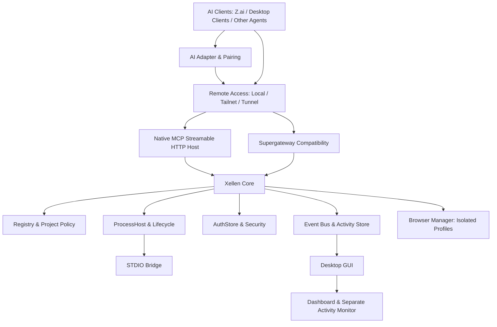

# MCP Xellen — Product Requirements Document (PRD)

**Versi:** 1.0  
**Tanggal:** 13 November 2026  
**Status:** Dokumen kebutuhan untuk implementasi terpadu  
**Nama produk:** MCP Xellen  
**Root project existing:** `D:\MCP-Bridge`

---

## 1. Ringkasan Produk

MCP Xellen adalah aplikasi desktop Windows untuk mengelola MCP server, project, koneksi AI, browser automation, akses jarak jauh, keamanan, dan observabilitas dalam satu aplikasi.

Masalah utama yang harus diselesaikan bukan sekadar menjalankan MCP server. Pengguna ingin AI yang tidak menyediakan integrasi MCP native—terutama Z.ai Website Agent Mode—dapat mengakses tool lokal melalui koneksi yang aman dan sesederhana mungkin. Pengguna juga membutuhkan dashboard yang memperlihatkan aktivitas AI secara langsung: AI/client mana yang terhubung, tool apa yang dipanggil, project apa yang diakses, proses apa yang berjalan, hasil eksekusi, durasi, penggunaan resource, dan error.

Implementasi harus mengembangkan repository yang sudah ada, bukan membuat produk baru dari nol atau menghapus stack yang masih digunakan.

## 2. Visi dan Tujuan

### Visi
Menjadikan MCP Xellen sebagai **Universal AI Gateway & Control Center** untuk komputer Windows: satu aplikasi untuk mengelola MCP server lokal dan remote, menghubungkannya ke berbagai AI client, serta memantau seluruh aktivitasnya.

### Tujuan produk
1. Mengurangi proses manual koneksi Z.ai, khususnya kebutuhan mengunggah file token dan menempel Magic Prompt berulang kali, sejauh kemampuan Z.ai memungkinkan.
2. Menyediakan MCP Streamable HTTP native dan dukungan STDIO.
3. Mengelola banyak MCP server dan banyak project secara terisolasi.
4. Menghilangkan kebocoran child process dan meningkatkan pengelolaan RAM.
5. Menyediakan dashboard real-time untuk aktivitas AI dan kondisi sistem.
6. Menyediakan keamanan berbasis identitas, project, dan server.
7. Mempertahankan kompatibilitas dengan endpoint dan workflow existing selama migrasi.
8. Menyediakan UI desktop modern yang tidak terkunci pada WinUI saja.

### Bukan tujuan
- Mengubah Z.ai Website Agent Mode menjadi MCP client native tanpa dukungan dari pihak Z.ai.
- Menjanjikan koneksi langsung dari internet ke laptop pada semua jaringan tanpa relay/tunnel. NAT/CGNAT dapat membuat koneksi inbound langsung tidak mungkin.
- Menghapus Tailscale, Supergateway, token, atau endpoint existing secara otomatis.
- Membuat ulang Desktop Commander, Construct 3 MCP, atau server pihak ketiga yang sudah berfungsi.
- Mengklaim kompatibilitas AI client sebelum diuji secara nyata.

## 3. Pengguna dan Use Case

### Persona utama
Pemilik laptop Windows yang menjalankan banyak project dan MCP server, menggunakan AI desktop maupun AI website, dan ingin mengontrol tool lokal dengan aman tanpa mengelola banyak terminal.

### Use case utama
- Menghubungkan Z.ai Website Agent Mode ke MCP Xellen.
- Menghubungkan MCP client desktop melalui STDIO atau Streamable HTTP.
- Menambahkan server MCP baru berbasis STDIO atau HTTP.
- Membuat project terpisah dengan server, token, endpoint, izin, dan browser profile masing-masing.
- Melihat aktivitas AI secara live dan menelusuri riwayat tool call.
- Menghentikan atau mencabut akses satu client/project tanpa mengganggu project lain.
- Mengetahui proses yang memakai RAM/CPU dan menemukan child process yatim.
- Mengaktifkan akses remote melalui profil Local, Tailnet, atau Internet Tunnel.

## 4. Prinsip Produk

1. **Existing-first:** audit dan pahami implementasi lama sebelum mengubahnya.
2. **No destructive migration:** endpoint, token, route, konfigurasi, dan data lama tidak boleh dihapus atau dirotasi otomatis.
3. **Observable by design:** setiap aktivitas penting harus tercatat dan dapat dilihat di dashboard.
4. **Least privilege:** setiap identitas hanya mendapat akses ke project/server/tool yang diizinkan.
5. **Evidence over claims:** status sukses harus berdasarkan handshake dan tool call nyata, bukan sekadar port terbuka atau health check.
6. **Graceful degradation:** kegagalan satu MCP server tidak boleh menjatuhkan seluruh aplikasi.
7. **Resource-aware:** lifecycle proses dan browser harus dikontrol; jangan membuat proses tanpa pemilik.
8. **UI separation:** business logic tidak boleh bergantung pada framework UI.
9. **User control:** operasi berisiko memerlukan konfirmasi eksplisit.
10. **No fake integration:** jika AI website belum menyediakan MCP/API native, tampilkan adapter workflow secara jujur.

## 5. Ruang Lingkup Fungsional

### 5.1 Dashboard & AI Activity Center — prioritas tertinggi
Dashboard bukan hanya halaman status server. Dashboard harus menjadi pusat observabilitas seluruh pekerjaan AI.

**Ringkasan dashboard**
- Jumlah AI/client aktif.
- Jumlah project aktif.
- Jumlah MCP server online/offline/error.
- Jumlah tool call berjalan, berhasil, gagal, dan dibatalkan.
- CPU dan RAM aplikasi beserta child process yang dimiliki Xellen.
- Uptime, status transport, status remote access, dan status koneksi.

**Live Activity Stream**
Setiap event minimal menampilkan:
- Waktu.
- Client/identitas AI.
- Project.
- MCP server.
- Nama tool atau jenis aktivitas.
- Ringkasan input yang sudah disanitasi.
- Status: queued, running, success, failed, cancelled, timeout.
- Durasi.
- Ringkasan output/error yang sudah disanitasi.

Pengguna dapat memfilter berdasarkan waktu, client, project, server, tool, status, dan tingkat risiko. Klik satu event membuka detail, termasuk correlation ID, request ID, durasi, status, dan log terkait.

**Penting:** jangan merekam token, password, cookie, header Authorization, isi file sensitif, atau nilai rahasia. Input/output tool dapat mengandung data sensitif; sediakan redaction, batas ukuran, dan pengaturan retensi. Default harus aman.

**Activity detail**
- Timeline lifecycle request.
- Identitas pemanggil dan scope izin.
- Tool dan server tujuan.
- Parameter yang telah disanitasi atau disembunyikan.
- Hasil ringkas, kode error, durasi.
- Link ke log terkait.
- Tombol cancel hanya jika operasi memang dapat dibatalkan dengan aman.

Dashboard harus menggunakan event push (misalnya SignalR/WebSocket atau mekanisme event internal yang sesuai), bukan polling agresif. Polling boleh menjadi fallback.

### 5.2 MCP Server Manager
- Tambah, edit, enable/disable, start, stop, restart server.
- Mendukung STDIO server dan HTTP upstream.
- Konfigurasi command, args, working directory, environment variables, transport, timeout, restart policy, dan resource policy.
- Template server yang sudah ada: Desktop Commander, Construct 3, Browser, dan custom server.
- Status lifecycle dan health per server.
- Uji koneksi melalui initialize, tools/list, dan optional tools/call yang aman.
- Simpan konfigurasi terpusat dan backup otomatis.
- Jangan menghapus konfigurasi existing saat migrasi.

### 5.3 Project Manager
Project memiliki:
- ID, nama, slug, status.
- Daftar server yang diizinkan.
- Identitas/token sendiri.
- Endpoint sendiri.
- Allowed roots dan policy.
- Browser profile sendiri bila digunakan.
- Client yang diizinkan.
- Log dan activity terpisah.

Project A tidak boleh membaca cookie, sesi browser, konfigurasi rahasia, atau aktivitas privat Project B kecuali diberi izin eksplisit.

### 5.4 Native MCP Transport
- Implementasi MCP Streamable HTTP native menggunakan SDK C# resmi yang kompatibel dengan .NET target repository.
- STDIO client bridge untuk menjalankan server MCP existing.
- Routing endpoint per server/project.
- Auth per identitas.
- Validasi Origin, rate limiting, ukuran request, timeout, dan session lifecycle.
- Mendukung JSON dan SSE sesuai spesifikasi MCP yang digunakan.
- Uji initialize, notifications/initialized, tools/list, tools/call, 401, session expiry, reconnect, dan SSE.
- Supergateway tetap menjadi compatibility mode sampai native transport lulus parity test.

### 5.5 AI Connect / Client Adapter
- Halaman untuk memilih project dan jenis AI client.
- Tombol generate connection package.
- Instruksi koneksi dibuat otomatis berdasarkan endpoint, transport, project, dan kemampuan client.
- Jangan menampilkan token mentah di UI, prompt, log, atau clipboard secara default.
- Pairing menggunakan kode sekali pakai dan credential terbatas scope serta masa berlaku.
- Revoke, expiry, dan rotasi credential.
- Sediakan adapter untuk AI website yang tidak memiliki MCP native jika memang diperlukan.
- Untuk Z.ai Website Agent Mode, hasilkan bootstrap instruction yang sesingkat mungkin dan client adapter yang menangani handshake, session, tools/list, tools/call, retry, dan SSE.
- Jangan mengklaim proses upload token atau prompt manual bisa hilang sepenuhnya sebelum diuji terhadap kemampuan aktual Z.ai. Jika platform tidak menyediakan API, MCP settings, persistent file, atau custom tools, keterbatasan tersebut harus dijelaskan dalam UI.

### 5.6 Browser Manager
- Browser server dikelola sebagai resource Xellen.
- Satu browser profile terpisah per project.
- Autentikasi wajib sebelum browser MCP menerima operasi dari client remote.
- Lazy start dan idle stop yang dapat dikonfigurasi.
- Profil browser persisten; stop tidak menghapus profil.
- Uji isolasi minimal dua project paralel: tab, cookie, login, navigasi, dan stop independen.
- Jangan memakai browser global bersama untuk project berbeda.
- Jangan menonaktifkan keamanan browser (misalnya `--disable-web-security`) tanpa alasan teknis yang dibuktikan dan persetujuan pengguna.
- Browser pribadi pengguna tidak boleh dikendalikan atau dibaca tanpa izin eksplisit.

### 5.7 Remote Access
Sediakan profil:
- Local only.
- Tailnet only.
- Public internet melalui tunnel provider yang didukung.

Tampilkan kondisi jaringan, endpoint, port, status TLS, dan instruksi perbaikan. Deteksi route lama yang tidak aktif dan laporkan, jangan menghapusnya otomatis. Perubahan Tailscale Funnel/Serve, Cloudflare Tunnel, firewall, port, DNS, atau service harus membutuhkan persetujuan eksplisit.

Aplikasi harus menjelaskan bahwa direct inbound access bergantung pada public IP/IPv6 dan kebijakan NAT/CGNAT. Relay/tunnel mungkin tetap diperlukan.

### 5.8 Process & Resource Manager
- Semua child process yang dibuat Xellen harus tercatat dalam Process Registry.
- Simpan PID, parent PID, command fingerprint, server/project owner, waktu mulai, status, dan resource usage.
- Graceful shutdown, timeout, forced termination hanya untuk process tree yang terbukti dimiliki Xellen.
- Orphan detection dan cleanup hanya untuk PID/process fingerprint yang tercatat atau cocok secara ketat.
- Dilarang membunuh semua `node.exe`, `chrome.exe`, atau proses generik milik aplikasi lain.
- Restart backoff dan crash recovery.
- Tampilkan RAM/CPU per server dan per child process.

### 5.9 Security Center
- Token per project/client/server sesuai model akses.
- Token dibuat dengan cryptographically secure random generator.
- Token tidak pernah ditampilkan kembali setelah pembuatan kecuali melalui alur ekspor satu kali yang aman.
- Penyimpanan terenkripsi Windows DPAPI bila sesuai.
- Revoke, expiry, rotation, least privilege.
- Rate limit dan Origin validation.
- Audit trail untuk login, pairing, perubahan konfigurasi, akses, dan tool call.
- Redaction rahasia pada seluruh log.
- Deteksi credential yang berpotensi bocor dalam file diagnostik; laporkan saja, jangan otomatis menghapus atau merotasi.
- Jangan pernah menaruh credential di URL query/fragment.

### 5.10 Logs, Settings, Backup & Recovery
- Log terstruktur dengan kategori dan severity.
- Rotasi log dan retensi yang dapat diatur.
- Filter, search, export, dan live follow.
- Backup konfigurasi sebelum migrasi.
- Restore dan validasi konfigurasi.
- Autostart opsional, default off.
- Graceful shutdown dan recovery setelah crash.

## 6. Persyaratan GUI / UX

### Keputusan arah UI
GUI **tidak boleh dibatasi pada WinUI**. Pisahkan UI dari Core agar framework UI dapat diganti tanpa menulis ulang business logic. Rekomendasi implementasi utama: evaluasi **Avalonia UI** sebagai desktop shell .NET lintas platform, dengan .NET 10-compatible stack. Jika repository existing lebih aman dipertahankan sementara, buat adapter/presentation layer yang memungkinkan migrasi UI bertahap. Jangan melakukan rewrite UI framework sebelum membuktikan build, binding, tray, window lifecycle, dan packaging.

Aplikasi harus memiliki desktop GUI utama dan jendela khusus **AI Activity Monitor** yang dapat dibuka terpisah, dipindahkan ke monitor lain, di-resize, dan tetap berjalan saat dashboard utama diminimize.

### Navigasi utama
- Dashboard
- AI Activity
- MCP Servers
- Projects
- AI Connections
- Browser
- Remote Access
- Security
- Logs
- Settings

### Visual design
Gunakan palet resmi:
- Slate: `#5D737E`
- Orange: `#FF8811`
- Ice/Cyan: `#C0FDFB`
- Sand/Yellow: `#F4D06F`
- Near Black: `#020402`

Arahan:
- Near Black untuk fondasi dark theme.
- Slate untuk panel sekunder, navigasi, dan permukaan.
- Orange untuk aksi utama, aktivitas aktif, dan indikator penting.
- Cyan untuk status informatif, koneksi, dan highlight.
- Yellow untuk warning dan perhatian.
- Warna status success/error tetap harus terbaca dan konsisten; palet utama tidak boleh mengorbankan aksesibilitas.
- Visual modern, profesional, padat informasi, bukan template dashboard generik.
- Tipografi jelas, hierarki kuat, whitespace terkontrol.
- Animasi singkat dan fungsional; hindari animasi dekoratif yang mengganggu.
- Semua komponen memiliki loading, empty, error, offline, disabled, dan success states.
- Dukungan keyboard navigation, scaling DPI, dan ukuran jendela berbeda.

### Activity Monitor layout
- Header: koneksi aktif, jumlah tool call berjalan, indikator live.
- Panel kiri: filter client/project/server/status.
- Panel utama: live activity stream dengan status dan durasi.
- Panel detail: request lifecycle, sanitized arguments, output summary, error, log correlation.
- Footer/status bar: RAM, CPU, event throughput, dropped event count, dan koneksi event stream.

## 7. Persyaratan Non-Fungsional

| Area | Persyaratan |
|---|---|
| Reliability | Crash satu server tidak menjatuhkan Core atau server lain |
| Performance | Tidak ada polling agresif; event stream efisien; ukur RAM aktual |
| Resource safety | Tidak ada child process tanpa owner dan lifecycle |
| Security | Least privilege, credential redaction, Origin validation, rate limit |
| Privacy | Default tidak menyimpan payload sensitif penuh |
| Compatibility | Endpoint lama dipertahankan selama dual-run |
| Maintainability | Core, transport, UI, storage, dan adapters terpisah |
| Accessibility | Kontras, keyboard, scaling DPI |
| Recovery | Backup konfigurasi, restore, restart policy |
| Observability | Semua tool call dapat ditelusuri melalui correlation ID |

## 8. Arsitektur Target

### Layer
1. **Core:** registry, process host, auth, configuration, event bus, logging, health, metrics.
2. **Transport:** native Streamable HTTP, STDIO bridge, compatibility bridge.
3. **Modules:** server manager, project manager, browser manager, remote access, AI connect.
4. **Presentation:** desktop shell, dashboard, separate activity monitor.
5. **Storage:** configuration, encrypted credentials, activity metadata, logs, backups.

## 9. Persyaratan Data & Event Model

Minimal event:
- `eventId`
- `correlationId`
- `timestampUtc`
- `eventType`
- `clientId`
- `projectId`
- `serverId`
- `toolName`
- `status`
- `durationMs`
- `riskLevel`
- `sanitizedInputSummary`
- `sanitizedOutputSummary`
- `errorCode`
- `processId` bila relevan

Jangan simpan raw authorization header, token, password, cookie, atau secret. Payload besar harus dipotong atau tidak disimpan. Retensi default harus konservatif dan dapat diubah.

## 10. Acceptance Criteria

### AC-01 Existing compatibility
- Aplikasi baru dapat membaca/memigrasikan konfigurasi existing tanpa kehilangan data.
- Endpoint 8023, 8025, 8024, Funnel 8443, dan Funnel 10000 tidak diubah otomatis.
- Supergateway tetap dapat dijalankan sebagai compatibility mode.

### AC-02 Native MCP
- Initialize dan tools/list berhasil melalui native endpoint.
- tools/call berhasil untuk tool uji yang aman.
- Request tanpa token ditolak dengan 401.
- Session expiry dan reconnect diuji.
- JSON dan SSE response diuji.
- Native parity report membandingkan hasil dengan compatibility mode.

### AC-03 Process lifecycle
- Setiap child process tercatat dengan owner.
- Shutdown Xellen membersihkan hanya process tree yang dimiliki.
- Restart Xellen tidak menghasilkan orphan dari proses yang dikelola Xellen.
- Tidak ada blanket kill untuk node/chrome.
- Bukti test dan PID dicatat.

### AC-04 AI Activity Monitor
- Tool call yang masuk tampil pada Activity Monitor tanpa refresh manual.
- Status queued/running/success/failed/timeout terlihat.
- Detail dapat dibuka berdasarkan correlation ID.
- Filter client/project/server/status berfungsi.
- Secret redaction diuji dengan test fixture.
- Event stream reconnect dan dropped-event behavior diuji.

### AC-05 Project isolation
- Dua project dapat aktif bersamaan.
- Token dan izin project tidak saling berlaku.
- Browser profile terpisah dan lolos uji cookie/tab/login.
- Stop satu project tidak menghentikan project lain.

### AC-06 Security
- Token tidak muncul di UI, prompt, log, URL, atau file diagnostik.
- Pairing code sekali pakai dan expiry diuji.
- Revoke langsung menolak credential lama.
- Rate limiting dan Origin validation diuji.
- Perubahan remote access membutuhkan konfirmasi.

### AC-07 GUI
- Dashboard dan Activity Monitor merupakan jendela yang dapat digunakan secara terpisah.
- Layout responsif pada ukuran jendela dan DPI berbeda.
- Semua halaman memiliki empty/loading/error states.
- Warna menggunakan palet resmi dan kontras tetap terbaca.
- UI tidak membekukan thread saat proses server berjalan.

### AC-08 Documentation
- README, architecture, setup, troubleshooting, security, compatibility matrix, dan implementation report diperbarui.
- Klaim kompatibilitas didukung hasil test.
- Semua keterbatasan Z.ai Website Agent Mode dinyatakan jujur.

## 11. Prioritas

**P0 — Stabilitas dan keamanan**
- Backup konfigurasi.
- Audit ulang runtime sebelum perubahan.
- Process lifecycle/orphan handling.
- Logging rotation dan redaction.
- Temuan credential exposure dilaporkan, tidak otomatis dihapus/dirotasi.
- Browser endpoint tidak boleh terbuka tanpa auth pada arsitektur baru.

**P1 — Core & observability**
- Registry, ProcessHost, Event Bus, LogService, Health/Metrics.
- Dashboard dan Activity Monitor real-time.

**P2 — Native MCP**
- Native Streamable HTTP + STDIO bridge.
- Dual-run dengan Supergateway.
- Parity test.

**P3 — Projects, AI Connect, Browser**
- Project isolation.
- Pairing/client adapter.
- Browser isolation.

**P4 — Remote Access & packaging**
- Remote access profiles.
- Installer, backup/restore, optional autostart.

Pekerjaan boleh dilakukan dalam satu implementasi terpadu, tetapi urutan dependency dan acceptance criteria tetap wajib. “Satu prompt” tidak berarti melewati test atau merusak layanan existing.

## 12. Risiko dan Batasan

- Z.ai Website Agent Mode mungkin tidak mendukung persistent custom MCP tools. Adapter Python/HTTP dan bootstrap instruction mungkin masih dibutuhkan.
- CGNAT atau jaringan kampus/hotel dapat menghalangi koneksi inbound langsung. Tunnel/relay mungkin tetap diperlukan.
- Native MCP SDK compatibility harus diverifikasi terhadap target framework dan versi package aktual.
- Migrasi WinForms ke Avalonia dapat memperluas scope. UI abstraction dan build proof wajib sebelum memutuskan rewrite.
- Audit runtime sebelumnya adalah snapshot 11 November 2026. Semua proses, port, dan route harus diperiksa ulang sebelum implementasi karena kondisi bisa berubah.

## 13. Definition of Done

Produk dinyatakan selesai hanya jika:
1. Seluruh acceptance criteria yang masuk scope lulus.
2. Build Release berhasil.
3. Automated tests dan integration tests lulus.
4. Native/compat parity report tersedia.
5. Activity Monitor terbukti menerima event tool call nyata.
6. Process lifecycle dan isolation memiliki bukti pengujian.
7. Existing endpoint dan konfigurasi tidak rusak.
8. Dokumentasi dan changelog diperbarui.
9. Ada rollback plan dan backup sebelum migrasi.
10. Tidak ada klaim “production ready” tanpa bukti.
