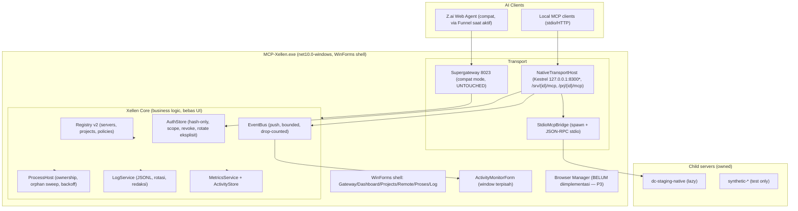

# MCP Xellen — Arsitektur Aktual (13 November 2026)

## Diagram aktual (faktanya dibangun & teruji)

*8300 = kandidat; host memilih port bebas berikut bila terpakai. Default config `enabled=false` (opt-in).

## Layer & aturan
1. **Core** (`Xellen/Core`): registry, process host, auth, config (schema v2 + backup), event bus, logging, health, metrics, redaction. NOL dependensi UI.
2. **Transport** (`Xellen/Transport`): native HTTP (manual per spec 2025-06-18 — lihat IMPLEMENTATION_REPORT §B untuk rationale), stdio bridge, compat bridge (Supergateway, eksternal).
3. **Modules**: Project Manager (Registry+AuthStore+UI), Remote Access viewer (read-only), Browser Manager (DEFERRED).
4. **Presentation** (`Xellen/UI`): WinForms shell + ActivityMonitorForm terpisah. Tidak memuat business logic.
5. **Storage**: `config/xellen.json` (schema v2 + backups), `config/auth.json` (hash-only + backups), `logs/` (xellen-core.log + activity.jsonl, rotasi), `runtime-state.json`.

## Dual-run & compatibility
- Supergateway 8023 (production saat ini, PID berubah-ubah — verifikasi runtime) **tidak pernah diubah**; native transport opt-in (`nativeTransport.enabled=true`), bind 127.0.0.1:8300-candidate.
- Parity: initialize + tools/list diuji native vs compat (T41). tools/call parity di DC menunggu sesi Z.ai nyata.

## Keputusan arsitektur penting
| Keputusan | Alasan | Status |
|---|---|---|
| Transport HTTP manual per spec (bukan SDK C#) | routing dinamis per server/project + auth per identitas + stdio bridge tidak diekspos bersih oleh SDK DI model; spec 2025-06-18 diverifikasi dari docs resmi | FACT (implementasi) + RECOMMENDATION (adopsi SDK saat multi-endpoint dinamis didukung) |
| Shell tetap WinForms sesi ini + Core terpisah | rewrite UI tanpa build proof dilarang brief §3E; kebutuhan hard (window terpisah, palet) tercapai | FACT + RECOMMENDATION (evaluasi Avalonia berikutnya) |
| Token hash-only + plaintext sekali-tulis ke file | PRD §5.9 | FACT (T33/T36) |
| Native transport opt-in default | dual-run aman; owner mengaktifkan sengaja | FACT (8300 free saat audit) |
